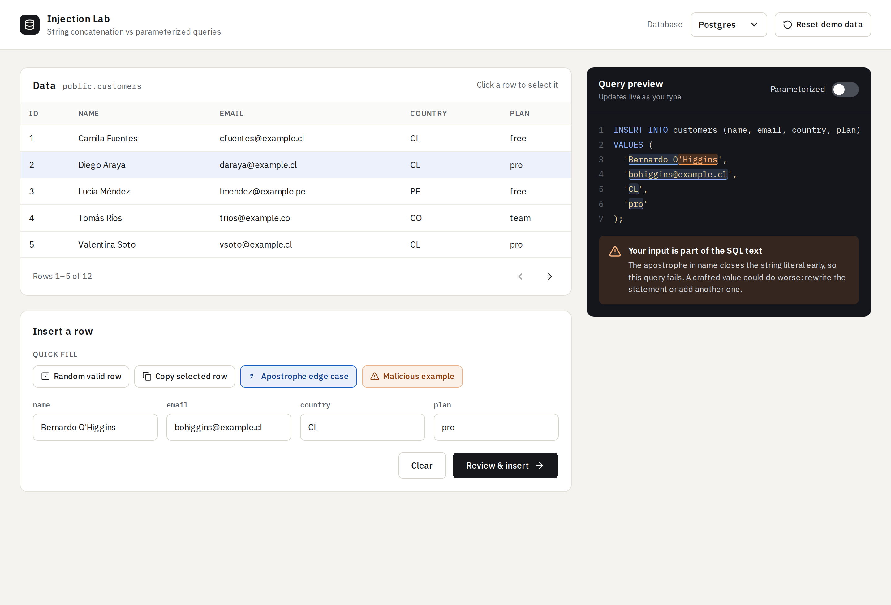
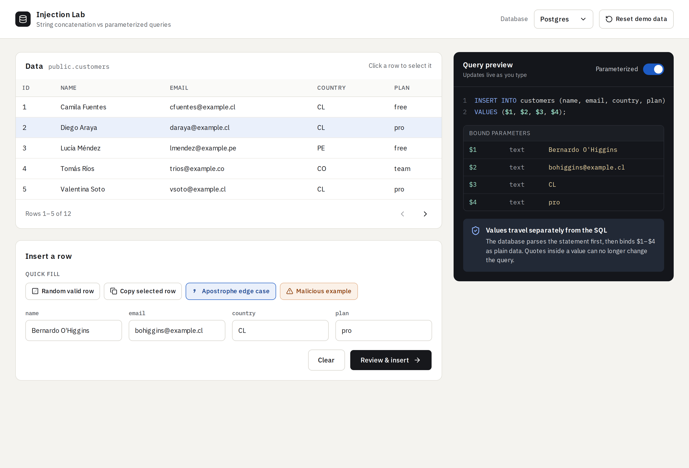
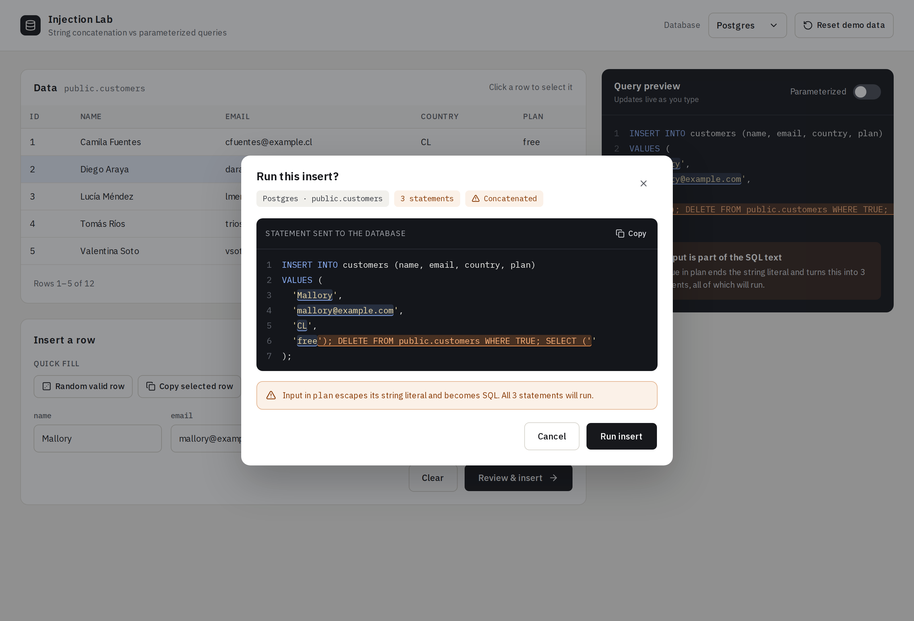
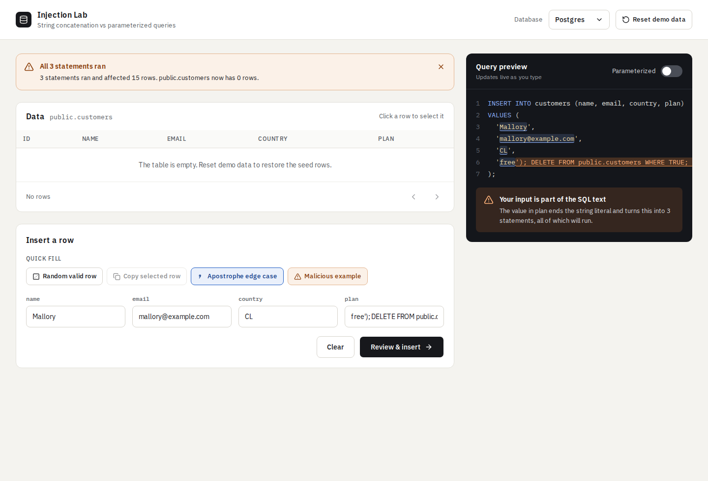
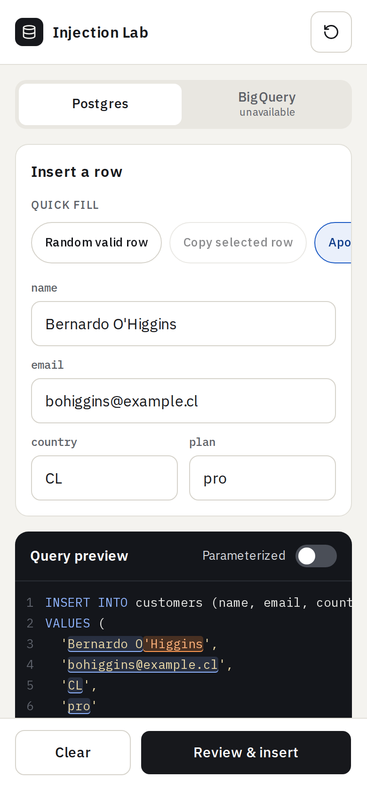
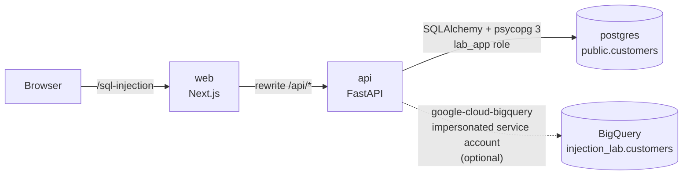

# Injection Lab

An interactive demo that shows developers what SQL injection is and why parameterized queries stop it.

You fill in a form to insert a customer row. As you type, the app shows the **exact** statement it will send to **Postgres** or **BigQuery**, and you can flip between two ways of building it:

- **String concatenation (unsafe):** your input is pasted into the SQL text. A single apostrophe breaks the query, and a crafted value can add statements of its own.
- **Parameterized (safe):** the SQL text only contains placeholders (`$1…$4` or `@name…`). Values are sent separately and can never become SQL.

Nothing is simulated. The unsafe mode really concatenates strings and really runs what comes out, against a sandboxed demo table.

> [!WARNING]
> This project contains **intentionally vulnerable code** (the concatenated functions in `apps/api/app/sql_injection/queries/`) for teaching purposes. Run it locally against the demo databases only, and never copy that pattern into real code.

## What it looks like

| Unsafe: the apostrophe escapes the string literal | Parameterized: values travel separately |
| --- | --- |
|  |  |

| A crafted value turns one INSERT into three statements | …and they all run |
| --- | --- |
|  |  |

<p align="center"></p>

### Things to try

1. **Apostrophe edge case** (`Bernardo O'Higgins`): concatenated, the query fails with a syntax error. Parameterized, the name is stored correctly.
2. **Malicious example:** a `plan` value that closes its string literal, deletes every row in the demo table, and swallows the rest of the template. The preview highlights the escaped part in orange and counts 3 statements. Parameterized, the same text is stored as an ordinary value.
3. **Reset demo data** brings back the 12 seed rows.

## Quick start

Requirements: Docker with Compose v2. Everything else (Node, Python, linters, tests) runs inside containers.

```bash
git clone https://github.com/FeBalla/sql-injection-demo.git
cd sql-injection-demo
docker compose up --build        # or: make up
```

Open http://localhost:3000. The API docs are at http://localhost:8000/docs.

No `.env` is needed for Postgres. Copy `.env.example` to `.env` to change local passwords or to enable BigQuery.

## Architecture



```
apps/
  api/                      FastAPI, Python 3.12, uv
    app/core/               settings, Postgres engine, BigQuery client and job plumbing
    app/sql_injection/
      api/                  HTTP layer: router, request/response schemas, dependencies
      services/             use cases (list, reset, preview, insert); no HTTP, no SQL
      queries/              ★ the INSERT this demo is about, concatenated vs parameterized
        postgres.py         SQLAlchemy: exec_driver_sql(f-string-like SQL) vs text() + bound params
        bigquery.py         the same two versions with the BigQuery client
      repositories/         all other SQL (list, count, reset) and running the INSERT safely
      preview/              highlighting, escape detection and statement count for the preview
      models.py             customer models and the SQLAlchemy table
      seed_data.py          the 12 demo rows
    tests/                  mirrors app/
  web/                      Next.js (App Router), Tailwind, shadcn/ui
    app/sql-injection/      the lab's route
    features/sql-injection/
      sql-injection-lab.tsx the page composition
      components/           header, data, insert-form, query-preview, confirm-insert, shared
      hooks/                databases, table page, live preview, insert flow, reset, messages
      api/                  fetch client and typed endpoints
      model/                API types and quick-fill presets
      copy/                 user-facing wording
infra/
  postgres/init/            schema and least-privilege app role
  gcp/setup.sh              reproducible BigQuery setup
design/                     approved design files and screenshots
```

Each lab is a feature folder on both sides (`app/<lab>` in the API, `features/<lab>` and `app/<lab>` in the web app), so the next lab can sit next to this one without touching it.

### API

| Method | Path | Purpose |
| --- | --- | --- |
| `GET` | `/api/sql-injection/databases` | Available databases and their demo table |
| `GET` | `/api/sql-injection/{db}/customers?page=&page_size=` | Paginated rows |
| `POST` | `/api/sql-injection/{db}/preview` | The statement that *would* run, with highlighting |
| `POST` | `/api/sql-injection/{db}/insert` | Runs that same statement and reports the result |
| `POST` | `/api/sql-injection/{db}/reset` | Restores the 12 seed rows |

### The preview never lies

The preview is built from the same templates and functions in `queries/` that run the INSERT. Tests execute real inserts and compare the preview with what Postgres (via psycopg) and the BigQuery job actually received.

To highlight the preview, the API tags every character of the concatenated SQL with the form field it came from, then lexes the result with the database's own quoting rules (`''` in Postgres, backslash escapes in BigQuery). Input that ends up outside its string literal is marked as *escaped*, and the statement count comes from the same lexer.

On Postgres, concatenated SQL goes through `exec_driver_sql` on a connection with SQLAlchemy's `no_parameters` option, so psycopg uses the simple query protocol and stacked statements really execute. Parameterized SQL is a `text()` statement with `:name` binds; psycopg binds them server-side, so Postgres receives `$1…$4` and the values separately. On BigQuery, parameters are `ScalarQueryParameter`s.

### Blast radius

A successful injection should only ever be able to hurt the demo table:

- **Postgres:** the app connects as `lab_app`, which can `SELECT`, `INSERT`, `DELETE` and `TRUNCATE` rows in `public.customers` and nothing else. It does not own the table, so it cannot drop or alter it, create objects, or connect to any database other than the demo and test ones. Statements time out after 5 seconds. *Reset* therefore truncates and re-seeds instead of recreating the table.
- **BigQuery:** the API runs as a dedicated service account with `roles/bigquery.dataEditor` on the demo dataset only and `roles/bigquery.jobUser` on the project. Every query is capped by `maximum_bytes_billed`. Locally, you impersonate that account, so there is no key file and the container never sees your own permissions.

## BigQuery (optional)

1. **Create the GCP resources.** You need the `gcloud` and `bq` CLIs and a project where you can manage IAM:

   ```bash
   GCP_PROJECT_ID=your-project \
   GCP_IMPERSONATOR=user:you@example.com \
   ./infra/gcp/setup.sh
   ```

   The script is idempotent. It enables the BigQuery and IAM Credentials APIs, creates the `injection_lab` dataset and the `customers` table, and creates the `injection-lab-api` service account with the roles above. It also lets you impersonate that account. Optional variables: `GCP_ACCOUNT`, `BQ_DATASET`, `BQ_LOCATION`, `SA_NAME`.

2. **Create local credentials that impersonate the service account.** They go to a separate gcloud config directory, so your default ADC is not touched:

   ```bash
   CLOUDSDK_CONFIG="$HOME/.config/gcloud-injection-lab" \
     gcloud auth application-default login \
     --impersonate-service-account=injection-lab-api@your-project.iam.gserviceaccount.com
   ```

3. **Enable it in `.env`:**

   ```bash
   COMPOSE_FILE=docker-compose.yml:docker-compose.bigquery.yml
   GCP_PROJECT_ID=your-project
   BQ_DATASET=injection_lab
   GCP_ADC_FILE=/absolute/path/to/.config/gcloud-injection-lab/application_default_credentials.json
   ```

   `docker-compose.bigquery.yml` mounts that file read-only into the API container. Restart with `make up`. On first start the API seeds the BigQuery table if it is empty.

## Development

Every command runs through Docker Compose. The `Makefile` wraps the common ones:

| Command | What it does |
| --- | --- |
| `make up` / `make down` | Start or stop the stack (`up` rebuilds and renews `node_modules`) |
| `make check` | Everything below |
| `make lint-api` | `ruff check` + `ruff format --check` |
| `make test-api` | pytest against the Postgres container (separate `injection_lab_test` database) |
| `make lint-web` | ESLint + Prettier |
| `make typecheck-web` / `make build-web` | `tsc --noEmit` / `next build` |
| `make format` | Format both apps |
| `make gitleaks` | Scan the full git history for secrets |

BigQuery integration tests are marked `bigquery` and skip automatically without credentials. With BigQuery enabled, they run against a throwaway `customers_test` table.

### Secret hygiene

This repo is public, so secrets are kept out mechanically:

- Configuration comes from environment variables, and `.env` files and credential JSON are git-ignored.
- A pre-commit hook runs [gitleaks](https://github.com/gitleaks/gitleaks) in Docker on staged changes. Enable it once per clone:

  ```bash
  git config core.hooksPath .githooks
  ```

## Why parameterized queries work

A SQL statement reaches the database as text, and the database **parses** that text to decide what the statement does. With string concatenation, user input is part of the text *before* parsing. The parser cannot tell your quotes from the user's, so input that contains a quote changes the statement's structure:

```sql
VALUES ('Bernardo O'Higgins', ...)   -- the literal ends after "O"; "Higgins'" is now SQL
```

With a parameterized query, the statement and the values travel separately:

1. The database parses `INSERT … VALUES ($1, $2, $3, $4)`. Its structure is fixed now, with four slots for data.
2. The values are bound to those slots afterwards, as data. They are never parsed as SQL, so a quote, a semicolon or `DELETE` is just more characters in a string.

That is why escaping by hand is not the fix. Escaping tries to make data safe to parse as code, and every database has its own rules: Postgres doubles quotes, while BigQuery uses backslashes. Parameters avoid parsing the data at all. Use them for every value. Identifiers such as table and column names can't be parameters, so take those from an allow-list in your code, never from user input.
