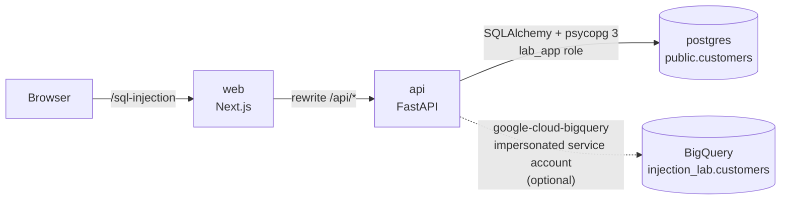

# Architecture



```
apps/
  api/                      FastAPI, Python 3.12, uv
    app/core/               settings and one connection module per database
      postgres.py           SQLAlchemy engine (psycopg 3, a fresh session per request)
      bigquery.py           client, job limits and error redaction
    app/sql_injection/
      api/                  HTTP layer: router, request/response schemas, dependencies
      services/             use cases (list, reset, preview, insert); no HTTP, no SQL
      queries/              ★ the INSERT this demo is about, concatenated vs parameterized
        postgres.py         SQLAlchemy: exec_driver_sql(f-string-like SQL) vs text() + bound params
        bigquery.py         the same two versions with the BigQuery client
      repositories/         all other SQL (list, count, reset) and running the INSERT safely
        postgres.py         timeouts, row counts and errors around queries/postgres.py
        bigquery.py         the same around queries/bigquery.py
      preview/              the statement preview: highlighting, escaped input, statement count
        builder.py          builds it from the templates in queries/
        analysis.py         colors each character and flags input that escaped its literal
        sql_syntax/         the lexer: each database's quoting, comment and parameter rules
      models.py             customer models and the SQLAlchemy table
      seed_data.py          the 12 demo rows
    tests/                  mirrors app/
  web/                      Next.js (App Router), Tailwind, shadcn/ui
    app/sql-injection/      the lab's route
    features/sql-injection/
      sql-injection-lab.tsx the page composition
      components/           header, data, insert-form, query-preview, confirm-insert, shared
      hooks/                databases, table page, live preview, insert flow, reset, messages
      api/                  fetch client and typed endpoints
      model/                API types and quick-fill presets
      copy/                 user-facing wording
infra/
  postgres/init/            schema and least-privilege app role
  gcp/setup.sh              reproducible BigQuery setup
design/                     approved design files and screenshots
```

Each lab is a feature folder on both sides (`app/<lab>` in the API, `features/<lab>` and `app/<lab>` in the web app), so the next lab can sit next to this one without touching it.

## API

| Method | Path | Purpose |
| --- | --- | --- |
| `GET` | `/api/sql-injection/databases` | Available databases and their demo table |
| `GET` | `/api/sql-injection/{db}/customers?page=&page_size=` | Paginated rows |
| `POST` | `/api/sql-injection/{db}/preview` | The statement that *would* run, with highlighting |
| `POST` | `/api/sql-injection/{db}/insert` | Runs that same statement and reports the result |
| `POST` | `/api/sql-injection/{db}/reset` | Restores the 12 seed rows |

## The preview never lies

The preview is built from the same templates and functions in `queries/` that run the INSERT. Tests execute real inserts and compare the preview with what Postgres (via psycopg) and the BigQuery job actually received.

To highlight the preview, the API tags every character of the concatenated SQL with the form field it came from, then lexes the result with the database's own quoting rules (`''` in Postgres, backslash escapes in BigQuery). Input that ends up outside its string literal is marked as *escaped*, and the statement count comes from the same lexer.

On Postgres, concatenated SQL goes through `exec_driver_sql` on a connection with SQLAlchemy's `no_parameters` option, so psycopg uses the simple query protocol and stacked statements really execute. Parameterized SQL is a `text()` statement with `:name` binds; psycopg binds them server-side, so Postgres receives `$1…$4` and the values separately. On BigQuery, parameters are `ScalarQueryParameter`s.

## Blast radius

A successful injection should only ever be able to hurt the demo table:

- **Postgres:** the app connects as `lab_app`, which can `SELECT`, `INSERT`, `DELETE` and `TRUNCATE` rows in `public.customers` and nothing else. It does not own the table, so it cannot drop or alter it, create objects, or connect to any database other than the demo and test ones. Statements time out after 5 seconds. *Reset* therefore truncates and re-seeds instead of recreating the table.
- **BigQuery:** the API runs as a dedicated service account with `roles/bigquery.dataEditor` on the demo dataset only and `roles/bigquery.jobUser` on the project. Every query is capped by `maximum_bytes_billed`. Locally, you impersonate that account, so there is no key file and the container never sees your own permissions.

## Why parameterized queries work

A SQL statement reaches the database as text, and the database **parses** that text to decide what the statement does. With string concatenation, user input is part of the text *before* parsing. The parser cannot tell your quotes from the user's, so input that contains a quote changes the statement's structure:

```sql
VALUES ('Bernardo O'Higgins', ...)   -- the literal ends after "O"; "Higgins'" is now SQL
```

With a parameterized query, the statement and the values travel separately:

1. The database parses `INSERT … VALUES ($1, $2, $3, $4)`. Its structure is fixed now, with four slots for data.
2. The values are bound to those slots afterwards, as data. They are never parsed as SQL, so a quote, a semicolon or `DELETE` is just more characters in a string.

That is why escaping by hand is not the fix. Escaping tries to make data safe to parse as code, and every database has its own rules: Postgres doubles quotes, while BigQuery uses backslashes. Parameters avoid parsing the data at all. Use them for every value. Identifiers such as table and column names can't be parameters, so take those from an allow-list in your code, never from user input.
